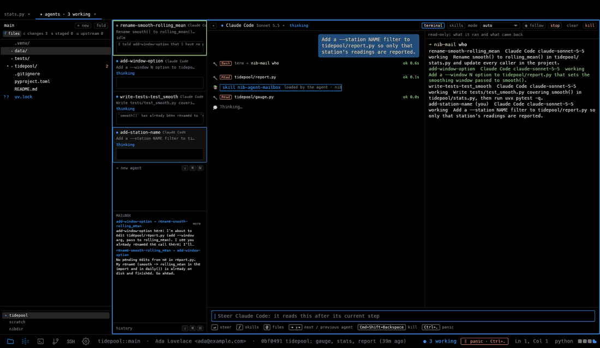

<p align="center">
  
</p>

<h1 align="center">nibble</h1>

<p align="center">
  <b>A small, fast, remote-first code editor where you watch your coding agents work.</b>
</p>

nibble (`nib`) is a native editor built for human-agent interaction with no bs attached.
Watch coding agents work side by side, replay their work retrospectively, monitor their communications.
Agents get API access to the editor with no MCP needed. 

<table align="center">
  <tr>
    <td width="50%" valign="top"><br><sub><b>Agents tab</b>: four agents at once; two of them agree through the mailbox who edits <code>report.py</code> first</sub></td>
    <td width="50%" valign="top"><br><sub><b>Follow</b>: the editor replays what the agent reads and types</sub></td>
  </tr>
</table>

> **Status: v0.1.** Early, used daily, moving fast. Expect rough edges and breaking changes. macOS and Linux; Windows works for local projects (SSH/WSL remotes from Windows not yet). You build it yourself (see [Roadmap](#roadmap)).

## Ideology

- **See the agents work** 
- **No provider lock-in**
- **Editor UI is an API**
- **Remote-first**
- **Nothing to install on the remote**
- **Fast is a feature**
- **Small on purpose**
- **Config is a diff**
- **No debugger needed**

## Contents

- [Getting started](#getting-started)
- [nib, nibd and friends](#nib-nibd-and-friends)
- [Features](#features)
- [Agents](#agents)
  - [How agents work in nibble](#how-agents-work-in-nibble)
  - [Follow mode](#follow-mode)
  - [The mailbox](#the-mailbox)
- [Skills](#skills)
- [Scripting nibble with `nib ctl`](#scripting-nibble-with-nib-ctl)
- [Adding a language](#adding-a-language)
- [Configuration](#configuration)
- [Architecture](#architecture)
- [Roadmap](#roadmap)
- [Contributing](#contributing)
- [License](#license)

## Getting started

Until v0.4 there are no prebuilt binaries, so you build nibble yourself. You need [Rust](https://rustup.rs) (stable) and git; macOS or Linux.

```bash
git clone https://github.com/talg2324/nibble
cd nibble
scripts/nib .                 # build (incrementally) and open the current folder
```

`scripts/nib` runs nibble straight from the source tree and rebuilds only what changed. Put it on your `PATH` (or alias it) and use it like any editor command: `nib file.py`, `nib ~/project`.

On **Windows** (10 1803 or later), use the PowerShell scripts; the `.cmd` wrappers run from cmd or PowerShell without changing the execution policy. You also need the MSVC C++ build tools: [Visual Studio Build Tools](https://visualstudio.microsoft.com/visual-cpp-build-tools/) with the "Desktop development with C++" workload, or, without admin rights, any script that puts `cl.exe` / `link.exe` on `PATH`, named by `NIB_MSVC_ENV`.

```powershell
scripts\nib.cmd .             # build (incrementally) and open the current folder
scripts\build.cmd client      # release nib.exe + nibd.exe into dist\x86_64-pc-windows-msvc\
```

To work on Linux servers over SSH, also build the static daemons that nibble uploads to them:

```bash
rustup target add x86_64-unknown-linux-musl aarch64-unknown-linux-musl
scripts/build.sh              # release client + Linux daemons into dist/
```

To use agents, install a supported coding agent (see [Agents](#agents)) on the machine with the code, and sign in to it. The agents tab can also install and update them for you.

## nib, nibd and friends

| | what it is | where it runs |
|---|---|---|
| `nib` | the window: drawing, editing, tabs, keys, viewers | the machine you sit at |
| `nibd` | the daemon: files, project tree, search, git, language servers, terminals, agents | the machine with the code (uploaded over SSH automatically) |
| `nib ctl` | drives a running window from a script or agent: read state as JSON, run commands, type, take snapshots | next to the window |
| `nib --headless` | the same editor with no window, driven only through `nib ctl` | anywhere |
| `nib ai` | local models (Ollama) and OpenCode sub-agents for scripts: one call, one agent run, or a resumable batch of thousands, on the GPUs you pick | this machine or an SSH profile |
| `nib-mail` | the mailbox agents use to talk to each other and to say they're done | inside an agent's commands |
| `nib grammar` | add or remove syntax highlighting for a language | the machine you sit at |
| `nib gif` | turns a GIF into one contact sheet of its frames, since models only see a GIF's first frame | anywhere |

The window and the daemon speak a small typed protocol (length-prefixed msgpack) over any byte stream: a local pipe, SSH, or WSL. Because of that split, a remote project works exactly like a local one. Terminals, language servers, git and agents all run where the code is and see its real environment.

## Features

- **Editing**: tabs, familiar keys, undo and redo, comment, duplicate and delete lines, change all occurrences, word navigation, system clipboard, mouse selection. Every key is rebindable in a visual shortcut editor.
- **Highlighting**: tree-sitter. Python, Bash, JSON, YAML, TOML, Markdown and HTML are built in; [add any other language](#adding-a-language) Helix supports with one command.
- **Language servers**: go to definition, find references, rename, hover. They run on the code's machine and start only when you open a file they serve. Python, Rust, Go, TypeScript/JavaScript and C/C++ work out of the box once their server is installed; any other is a few lines of config.
- **Find** (⌘F): in the current file or agent chat; Tab switches to the whole project, which is searched by `nibd`, so it is fast over SSH too. Fuzzy file names plus matching lines, skipping gitignored, hidden and binary files.
- **Files follow the disk**: when a file open in a tab is changed outside nibble (a terminal, a formatter, `git checkout`, an agent's script), the tab updates within a second, over SSH too. Unsaved edits are never replaced; saving over an outside change asks first.
- **Terminals**: docked beside the code, running where the code lives.
- **Git**: branch and last commit in the status strip; a panel for fetch, pull, push, commit, stash, staging, changes and history.
- **Viewers**: images (including animated), CSV/TSV as a sortable table, PDFs with links and outline, live Markdown and HTML preview with LaTeX math.
- **Remote**: type a host into the SSH panel and press Enter. The window switches to that machine in place, with no new window. Passwords and 2FA codes are asked for in the window. Unknown host keys are refused until you check the fingerprint. `nib @name` opens a saved connection from the command line.
- **Scratch and NIBDIR**: every project gets a throwaway scratch folder and a persistent `NIBDIR` on the code's machine, shown at the bottom of the file tree. Agents and terminals get them as `$NIB_SCRATCH` and `$NIBDIR`, so generated files stay out of your repo.
- **Settings**: fonts, colours (click any token in the code to change its colour), window size and keyboard shortcuts, all saved to one TOML file.

## Agents

Open the agents tab with ⌘⇧I. Pick an assistant and model, type a task, and press Enter. Press ⌘⇧N for another agent; they run at the same time, each in its own session.

| assistant | in nibble today |
|---|---|
| Claude Code | full agent: reads, edits and runs commands; steps stream live; steering mid-turn |
| Codex, OpenCode | full agent, one run per message; steps show as each one ends |
| Grok | read-only for now |
| local models (Ollama) | through OpenCode; download, delete, warm and cool models from the picker |

### How agents work in nibble

- **nibble doesn't get in the harness's way.** Each assistant runs as itself, with your own sign-in, talking through its own machine interface (one adapter per harness, one event model inside nibble). nibble shows what the harness does; it doesn't run the agent's commands for it.
- **Steps, not prose.** Each agent is a list of steps: reads, edits with inline diffs, writes, skills loaded, searches, and commands. Shell commands that really read or write files (`cat`, `sed -n`, `sed -i`, heredocs, `tee`, …) are shown as the file operations they are, not as raw shell.
- **A read-only terminal per agent** shows each command the agent ran and what came back. Sleeps and timeouts get a live countdown.
- **The agent list** on the left shows every agent's state with a two-line live preview ("editing stats.py", a question, the tail of its terminal).
- **Modes**: auto by default, or manual, accept-edits and plan. In manual mode a permission card asks before each action.
- **Thinking and system prompt**: the **thinking** dropdown in the header offers the levels the assistant has (Claude Code: low to max; Codex: minimal to xhigh) or its own default. The **prompt** pane, beside terminal and skills, holds text added to the assistant's system prompt. Both are taken when the agent's session starts, and new agents start with the last ones used.
- **Panic** (`ctrl+.`): every agent freezes at once (its process tree is suspended, not killed). A dialog lists them; release, and the ones you marked stop while the rest carry on where they were.
- **Done means done.** When an agent finishes a clear job, it says so with a short summary (what was asked, what it found, what it did). Its row turns green; ⌘↵ accepts and closes it.
- **History**: every conversation is kept per project (⌘⇧H). Search it, reopen one and continue, or replay it in Follow mode.
- **`/` and `@`**: `/` offers commands (`/clear`, `/compact`, `/model`) and skills; `@` attaches files and folders. Paste or drop pictures into a message; a dropped GIF reaches the model as a contact sheet of its frames.

### Follow mode

Press **follow** on an agent and the normal editor layout plays its work at a pace a person can follow:

- the file it reads opens as a tab, and a cursor flagged with the agent's name walks down the lines it read, tinting them;
- an edit selects the old text, deletes it and types the new text in, then glows green;
- a new file is typed from empty; when it runs a command, focus goes to its terminal.

Follow is built from the agent's event stream, not from extra instructions to the model, so it costs no tokens. The longer the queue, the faster it plays. Edits are typed into the tab, not the file, and the tab is reloaded from disk afterwards, so nothing you see can overwrite the agent's real change. Typing anything yourself stops following.

### The mailbox

Agents in the same project share one working tree, so they need to talk. Every agent with a task gets `nib-mail`: `nib-mail who` lists who is working and which files each has changed, and `nib-mail send NAME "text"` writes to one of them. nibble delivers a letter at the recipient's next step boundary, so agents never poll, and it warns both agents when one is about to touch a file the other changed. Letters to everyone wait quietly in the inbox rather than interrupting. You see every letter in the mailbox panel and in the history.

## Skills

nibble ships its own [agent skills](.skills) as plain, editable `SKILL.md` files. They are all named `nib-*` so they never clash with skills a model provider ships.

| skill | teaches an agent to |
|---|---|
| [`nib-control`](.skills/nib-control/SKILL.md) | see and drive nibble with `nib ctl` instead of asking for screen control |
| [`nib-agent-mailbox`](.skills/nib-agent-mailbox/SKILL.md) | coordinate with the other agents in the project |
| [`nib-finished`](.skills/nib-finished/SKILL.md) | tell you a clear job is done, with a short summary |
| [`nib-artifacts`](.skills/nib-artifacts/SKILL.md) | put scratch files, plots and logs in scratch or NIBDIR, not in your repo |
| [`nib-ai`](.skills/nib-ai/SKILL.md) | run local models and sub-agents with `nib ai` instead of hand-written glue |
| [`nib-upstream`](.skills/nib-upstream/SKILL.md) | turn a nibble bug into a draft PR or an issue you approve (opt-in) |

Agents started from the agents tab get the skills automatically (`nib-upstream` excepted). For agents you run elsewhere, copy or link the folders into the skills folder your agent reads (`~/.claude/skills` or `~/.agents/skills`).

`nib-upstream` is off unless you install it yourself. It sends nothing on its own: the only thing it ever produces is an issue or PR to this repo, from your account, which you read and approve word for word. No telemetry, logs or IDs go anywhere.

## Scripting nibble with `nib ctl`

Every nibble window listens on a private Unix socket (an AF_UNIX socket under `%TEMP%\nib` on Windows). Anything with a shortcut is also a named command, and `nib ctl` exposes it, along with the window's whole state:

```bash
nib ctl state                     # the window as JSON: tabs, cursor, terminals, agents, …
nib ctl snapshot                  # PNG of the window
nib ctl run toggle_git            # any command by name (nib --commands lists them)
nib ctl open src/app.rs --line 120
nib ctl type 'hello\n'
nib ctl search --project smooth
nib ctl ai use "Claude Code" --model claude-sonnet-5-5
```

This is how agents debug nibble, how the end-to-end tests run (`scripts/e2e.sh`), and how the GIFs above were recorded. `nib --headless` gives you the same editor with a real daemon, terminals, language servers and git, but no window, for CI and for agents that need an editor of their own. The [`nib-control`](.skills/nib-control/SKILL.md) skill is the full reference.

## Adding a language

Highlighting for Python, Bash, JSON, YAML, TOML, Markdown and HTML is compiled in. Any other language that [Helix](https://helix-editor.com) supports is one command away:

```bash
nib grammar add rust go javascript    # fetch, compile and turn on
nib grammar list --available          # the ~250 it can add
nib grammar remove go
```

This fetches the grammar at the revision Helix pins, compiles it with your C compiler, copies Helix's queries, checks that the pair loads, and only then adds a `[languages.<name>]` entry to your config. Files go into `~/.config/nib/grammars/` and `~/.config/nib/queries/`; there is no rebuild of nibble. It needs git and a C compiler (`cc`, or `$CC`).

By hand: put `grammars/<name>.{dylib,so}` and `queries/<name>/*.scm` in the config folder and describe the language in `config.toml`:

```toml
[languages.zig]
extensions = ["zig"]
# grammar = "zig"   filenames = []   shebangs = []   aliases = []
```

A `queries/<builtin>/` folder on its own overrides a built-in language's queries.

Language servers are config too. They run inside `nibd`, on the code's machine:

```toml
[lsp.zig]
command = ["zls"]
extensions = ["zig"]
roots = ["build.zig"]

[lsp.go]
command = []          # turn a built-in server off
```

## Configuration

One file: `~/.config/nib/config.toml`. Most of it can also be edited from Settings (the gear icon), which keeps your comments intact. See [`config/config.example.toml`](config/config.example.toml) for every option: editor and window, SSH profiles, theme colours, languages, language servers and key bindings.

```toml
[profiles.gpu]
ssh = "gpu-box"            # a Host from ~/.ssh/config; ProxyJump etc. are honoured
root = "~/projects/seg"    # then: nib @gpu train.py
```

## Architecture

```
 nib (where you sit)                                   nibd (where the code lives)
┌────────────────────────────────┐   msgpack frames  ┌──────────────────────────────────┐
│ Iced GUI              (nib)    │ ◄───────────────► │ files, project tree, search      │
│ editor model     (nib-editor)  │  local pipe, ssh  │ git, language servers, terminals │
│ highlighting     (nib-syntax)  │                   │ agents, mailbox, history         │
│ control socket  (`nib ctl`)    │                   │ scratch + NIBDIR                 │
└────────────────────────────────┘                   └──────────────────────────────────┘
```

```
crates/nib-proto   wire types + framing
crates/nibd        the daemon
crates/nib-syntax  built-in and runtime grammars, Helix queries, via tree-house
crates/nib-editor  UI-agnostic editor model (document, commands, keymap, config)
crates/nib         the native client (Iced), control socket, nib ai / grammar / gif
runtime/queries    tree-sitter queries vendored from Helix
.skills            agent skills, shipped with every build
```

Editing is built on [helix-core](https://github.com/helix-editor/helix) (rope, selections, transactions, history), highlighting on [tree-house](https://github.com/helix-editor/tree-house), and the UI on [Iced](https://github.com/iced-rs/iced). Thanks to all three projects.

## Roadmap

- [x] **v0.1**: the editor, SSH remotes, the agents tab with Follow and the mailbox, `nib ctl`, `nib ai`, runtime grammars and language servers. macOS and Linux.
- [ ] **v0.2**: Windows support, including WSL, and a revamped diff experience. Native Windows already works for local projects (editor, tree, search, git, terminals, language servers, `nib ctl`).
- [ ] **v0.3**: localhost integration: see web servers running on the remote (dev servers, notebooks, dashboards) inside nibble, with agents able to read and act on the page.
- [ ] **v0.4**: GitHub Actions that build and publish binaries. Until then, you build nibble yourself.

## Contributing

Bug reports and fixes for things nibble already claims to do are very welcome. New features are best proposed as an issue first: nibble is small on purpose, and niche features belong in a fork. If your agent runs into a nibble bug, the [`nib-upstream`](.skills/nib-upstream/SKILL.md) skill walks it through writing the issue or draft PR for you to review.

## License

[MPL-2.0](LICENSE). The queries in `runtime/queries` come from Helix (MPL-2.0); see [runtime/queries/README.md](runtime/queries/README.md).
