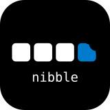
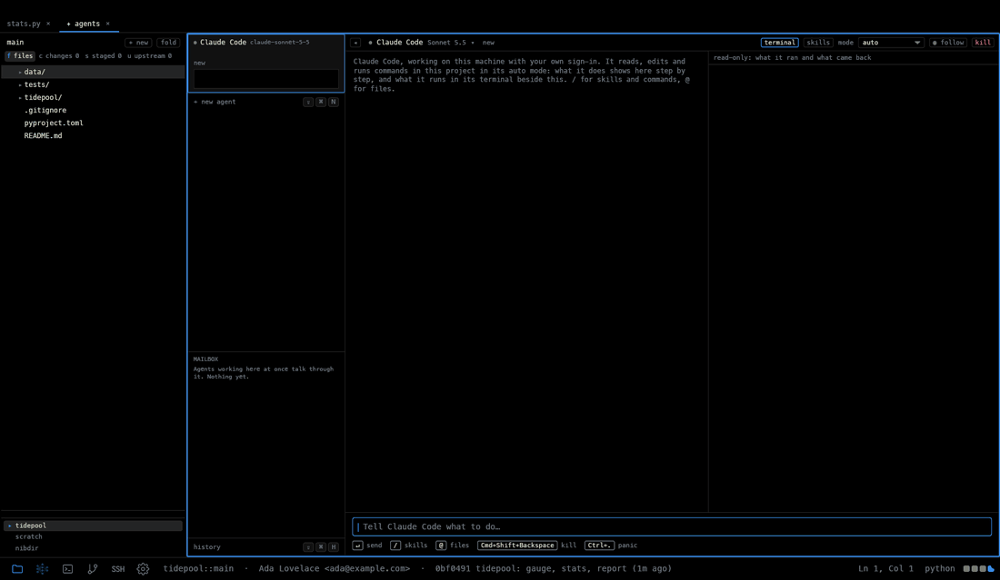

<p align="center">
  
</p>

<h1 align="center">nibble</h1>

<p align="center">
  <b>A small, fast, remote-first code editor to watch your agents work.</b>
</p>

nibble (`nib`) is a native editor built for human-agent interaction with no bs attached.
Watch coding agents work side by side, replay their work retrospectively, monitor their communications.
Agents get API access to the editor with no MCP needed. 

<table align="center">
  <tr>
    <td width="50%" valign="top"><br><sub><b>Agents tab</b>: four agents at once; two of them agree through the mailbox who edits <code>report.py</code> first</sub></td>
    <td width="50%" valign="top"><br><sub><b>Follow</b>: the editor replays what the agent reads and types</sub></td>
  </tr>
</table>

> **Status: v0.4.** Early, used daily, moving fast. Expect rough edges and breaking changes. Prebuilt for macOS (Apple silicon), Linux (x86_64) and Windows (x86_64), for local projects and SSH remotes; nibble also runs inside WSL. See [Install](#install), or [build it from source](#building-from-source).

## Why nibble

With coding agents, the human is the bottleneck. Agents get a lot done fast, and without oversight it turns into slop. nibble is built so one person can keep up with several agents working at once.

- **See the agents work.** Every read, edit and command is a step you can watch; Follow replays them in the editor; the mailbox shows what agents tell each other. One key freezes them all so you can step in.
- **Review where you chat.** Comment on an agent's plan or diff and send it back. Accepting lands its branch as one commit.
- **No provider lock-in.** Claude Code, Codex, OpenCode and local models side by side. Switch provider or model mid-chat.
- **The editor UI is an API.** Anything with a shortcut is a command agents and scripts can run with `nib ctl`. No MCP, no screen control. Agents see your app's pages through `nib-web`, which opens pages served by the machine they run on and no others. (A page may still load what it references from elsewhere, as it would in your browser: images, fonts, API calls.)
- **Remote-first, nothing to install.** nibble uploads its daemon over SSH. Terminals, language servers, git and agents run where the code is.
- **Fast is a feature.** A native app, not a browser in a window.
- **Small on purpose.** No extension API; niche features belong in a fork.
- **Config is a diff.** Defaults are built in; your `config.toml` holds only what you changed.
- **No debugger.** Agents debug with throwaway scripts and logs, so nibble doesn't ship one.

## Contents

- [Install](#install)
- [Building from source](#building-from-source)
- [nib, nibd and friends](#nib-nibd-and-friends)
- [Features](#features)
- [Agents](#agents)
  - [How agents work in nibble](#how-agents-work-in-nibble)
  - [Follow mode](#follow-mode)
  - [The mailbox](#the-mailbox)
- [Local apps](#local-apps)
- [Apps](#apps)
- [Skills](#skills)
- [Scripting nibble with `nib ctl`](#scripting-nibble-with-nib-ctl)
- [Adding a language](#adding-a-language)
- [Configuration](#configuration)
- [Architecture](#architecture)
- [Roadmap](#roadmap)
- [Contributing](#contributing)
- [License](#license)

## Install

**macOS, Linux and WSL:**

```bash
curl -fsSL https://github.com/talg2324/nibble/releases/latest/download/install.sh | bash
```

**Windows** (PowerShell):

```powershell
irm https://github.com/talg2324/nibble/releases/latest/download/install.ps1 | iex
```

The installer shows what it found (your machine, the coding agents you have) and a short checklist, then downloads the latest release and checks it against the release's `SHA256SUMS`. If you have the GitHub CLI and are signed in, it also checks the release's build provenance (`gh attestation verify`: that nibble's own release workflow built those files) and stops if that fails; without `gh` it says the check was skipped. You get:

- `nib` and `nibd`: in `~/.local/lib/nib` with commands in `~/.local/bin` (macOS, Linux), or in `%LOCALAPPDATA%\Programs\nib` (Windows); optionally added to your `PATH`;
- an app icon: `~/Applications/nibble.app` on macOS, a `.desktop` entry on Linux, a Start menu shortcut on Windows;
- nibble's [agent skills](#skills), in `~/.claude/skills` and `~/.agents/skills`;
- if you choose it, the Linux daemons nibble uploads to [SSH remotes](#nib-nibd-and-friends) (and, from Windows, into WSL); on by default when `~/.ssh/config` has hosts or Windows has WSL distros.

Run the same line again to update in place; your settings stay. Options go after `bash -s --` (`--yes`, `--remotes`, `--prefix DIR`, `--version TAG`, `--uninstall`; `--help` lists them all); on Windows they are `-Yes`, `-Remotes`, `-Version TAG`, `-Uninstall`, … (see the top of `install.ps1`). The installers take the latest release, never a release candidate; `--version v0.5-rc.1` (or `NIB_VERSION=v0.5-rc.1`) installs one by name. The Linux build runs on glibc 2.35 or later (distros from 2022 on).

Rather download by hand? Each [release](https://github.com/talg2324/nibble/releases) has the archives the installer uses: `nibble-<version>-<platform>` (nib, nibd and the skills), `nibd-<version>-<linux platform>` (the daemon for remotes) and `nib-grammars-<version>-<platform>` (the [languages](#adding-a-language) offered on first run, prebuilt). The macOS binaries are not notarized, so a copy downloaded in a browser needs `xattr -dr com.apple.quarantine` on its folder; the installer does that for you.

To use agents, install a supported coding agent (see [Agents](#agents)) on the machine with the code, and sign in to it. The agents tab can also install and update them for you.

## Building from source

For working on nibble itself, or a platform the releases don't cover (Intel Macs, Linux on ARM). You need [Rust](https://rustup.rs) (stable) and git; on Linux also `pkg-config`, `libxkbcommon-dev` and `libwayland-dev` (or your distro's names for them).

```bash
git clone https://github.com/talg2324/nibble
cd nibble
scripts/dev/nib .             # build (incrementally) and open the current folder
```

`scripts/dev/nib` runs nibble straight from the source tree and rebuilds only what changed. Put it on your `PATH` (or alias it) and use it like any editor command: `nib file.py`, `nib ~/project`.

On **Windows** (10 1803 or later), use the PowerShell scripts; the `.cmd` wrappers run from cmd or PowerShell without changing the execution policy. You also need the MSVC C++ build tools: [Visual Studio Build Tools](https://visualstudio.microsoft.com/visual-cpp-build-tools/) with the "Desktop development with C++" workload, or, without admin rights, any script that puts `cl.exe` / `link.exe` on `PATH`, named by `NIB_MSVC_ENV`.

```powershell
scripts\dev\nib.cmd .         # build (incrementally) and open the current folder
scripts\build\build.cmd client  # release nib.exe + nibd.exe into dist\x86_64-pc-windows-msvc\
```

To work on Linux servers over SSH, also build the static daemons that nibble uploads to them:

```bash
rustup target add x86_64-unknown-linux-musl aarch64-unknown-linux-musl
scripts/build/build.sh        # release client + Linux daemons into dist/
```

## nib, nibd and friends

| | what it is | where it runs |
|---|---|---|
| `nib` | the window: drawing, editing, tabs, keys, viewers | the machine you sit at |
| `nibd` | the daemon: files, project tree, search, git, language servers, terminals, agents | the machine with the code (uploaded over SSH automatically) |
| `nib ctl` | drives a running window from a script or agent: read state as JSON, run commands, type, take snapshots | next to the window |
| `nib --headless` | the same editor with no window, driven only through `nib ctl` | anywhere |
| `nib ai` | local models (Ollama) and OpenCode sub-agents for scripts: one call, one agent run, or a resumable batch of thousands, on the GPUs you pick | this machine or an SSH profile |
| `nib-mail` | the mailbox agents use to talk to each other and to say they're done | inside an agent's commands |
| `nib-app` | registers, starts, stops and reads the project's apps | inside an agent's commands |
| `nib-web` | reads and operates a page of the project's app in the window's web tab | inside an agent's commands |
| `nib grammar` | add or remove syntax highlighting for a language | the machine you sit at |
| `nib gif` | turns a GIF into one contact sheet of its frames, since models only see a GIF's first frame | anywhere |

The window and the daemon speak a small typed protocol (length-prefixed msgpack) over any byte stream: a local pipe, SSH, or WSL. Because of that split, a remote project works exactly like a local one. Terminals, language servers, git and agents all run where the code is and see its real environment.

## Features

- **Editing**: tabs, familiar keys, undo and redo, comment, duplicate and delete lines, change all occurrences, word navigation, system clipboard, mouse selection. Every key is rebindable in a visual shortcut editor.
- **Highlighting**: tree-sitter. Bash, JSON, YAML, TOML, Markdown and HTML are built in; on first run nib offers Python, Rust, Go, Zig, Java, JavaScript, Typst and LaTeX, and [any other language](#adding-a-language) Helix supports is one command.
- **Language servers**: go to definition, find references, rename, hover. They run on the code's machine and start only when you open a file they serve. Python, Rust, Go, TypeScript/JavaScript, C/C++, Typst (tinymist) and LaTeX (texlab) work out of the box once their server is installed (a missing one says how to install it); any other is a few lines of config.
- **Find** (⌘F): in the current file or agent chat; Tab switches to the whole project, which is searched by `nibd`, so it is fast over SSH too. Fuzzy file names plus matching lines, skipping gitignored, hidden and binary files.
- **Files follow the disk**: when a file open in a tab is changed outside nibble (a terminal, a formatter, `git checkout`, an agent's script), the tab updates within a second, over SSH too. Unsaved edits are never replaced; saving over an outside change asks first.
- **Typst and LaTeX**: saving a `.typ` or `.tex` file runs `typst` / `latexmk` on the code's machine; the PDF shows beside the source and follows each build, and errors are marked on their lines. A `% !TEX root = main.tex` (or `// !typst root = main.typ`) line compiles the root file instead. Settings → Languages shows where each compiler was found, or how to install it, and takes another path; `[compile.<lang>]` in the config changes the command.
- **Terminals**: docked beside the code, running where the code lives.
- **Servers**: the project's backend, frontend, TensorBoard or notebook server, started by nibble instead of kept alive in a split terminal. See [Apps](#apps).
- **Git**: branch and last commit in the status strip; a panel for fetch, pull, push, commit, stash, staging, changes and history.
- **Viewers**: images (including animated), CSV/TSV as a sortable table, PDFs with links and outline, live Markdown and HTML preview with LaTeX math and Mermaid diagrams.
- **Remote**: type a host into the SSH panel and press Enter. The window switches to that machine in place, with no new window. Passwords and 2FA codes are asked for in the window. Unknown host keys are refused until you check the fingerprint. `nib @name` opens a saved connection from the command line.
- **Scratch and NIBDIR**: every project gets a throwaway scratch folder and a persistent `NIBDIR` on the code's machine, shown at the bottom of the file tree. Agents and terminals get them as `$NIB_SCRATCH` and `$NIBDIR`, so generated files stay out of your repo.
- **Settings**: fonts, colours (click any token in the code to change its colour), window size and keyboard shortcuts, all saved to one TOML file.

## Agents

Open the agents tab with ⌘⇧I. Pick an assistant and model, type a task, and press Enter. Press ⌘⇧N for another agent; they run at the same time, each in its own session.

| assistant | in nibble today |
|---|---|
| Claude Code | full agent: reads, edits and runs commands; steps stream live; steering mid-turn |
| Codex | full agent, one run per message; can pause for questions; steps show as each one ends |
| OpenCode | full agent, one run per message; steps show as each one ends |
| Grok | read-only for now |
| local models (Ollama) | through OpenCode; download, delete, warm and cool models from the picker |

### How agents work in nibble

- **nibble doesn't get in the harness's way.** Each assistant runs as itself, with your own sign-in, talking through its own machine interface (one adapter per harness, one event model inside nibble). nibble shows what the harness does; it doesn't run the agent's commands for it.
- **Steps, not prose.** Each agent is a list of steps: reads, edits with inline diffs, writes, skills loaded, searches, and commands. Shell commands that really read or write files (`cat`, `sed -n`, `sed -i`, heredocs, `tee`, …) are shown as the file operations they are, not as raw shell.
- **A read-only terminal per agent** shows each command the agent ran and what came back. Sleeps and timeouts get a live countdown.
- **The agent list** on the left shows every agent's state with a two-line live preview ("editing stats.py", a question, the tail of its terminal).
- **Modes**: auto by default, or manual, accept-edits and plan. Claude Code asks through a permission card in manual mode. Codex can pause for questions through its app-server; its per-action permission cards are not yet wired into nibble. For Codex, manual and plan run read-only, while auto and accept-edits use its workspace-write sandbox.
- **Thinking and system prompt**: the **thinking** dropdown in the header offers the levels the assistant has (Claude Code: low to max; Codex: the selected model's supported levels from its catalog) or its own default. The **system** pane, beside terminal and skills, holds text added to the assistant's system prompt. Both are taken when the agent's session starts; each agent keeps its own, and new agents (in this nib or the next) start with the last ones set, kept in `[ai] effort` / `prompt` in config.toml.
- **Panic** (`ctrl+.`): every agent freezes at once (its process tree is suspended, not killed). A dialog lists them; release, and the ones you marked stop while the rest carry on where they were.
- **Done means done.** When an agent finishes a clear job, it says so with a short summary (what was asked, what it found, what it did). Its row turns green; ⌘↵ accepts and closes it.
- **Worktree-per-feature (WPF)**, the switch beside terminal / skills / system, on by default: every agent that changes files does it on a branch of its own in a work tree of its own (`nib-work`), and ⌘↵ lands that branch on yours as one commit. nibble holds agents to it: the first message says so, Claude Code's edit tools are refused in your project folder, an agent that changes a file there anyway is told to move it (`nib-work start --carry`), and an agent that still has files there cannot say it is done; ⌘↵ sends it back instead of leaving them uncommitted in your tree. Off (`[ai] worktree_per_feature = false` in config.toml, or `nib ctl ai wpf off`): agents edit your project folder, nothing is committed for them, and the done dialog lists the files left in your tree.
- **History**: every conversation is kept per project (⌘⇧H). Search it, reopen one and continue, or replay it in Follow mode.
- **`/` and `@`**: `/` offers commands (`/clear`, `/compact`, `/model`) and skills; `@` attaches files and folders. Paste or drop pictures into a message; a dropped GIF reaches the model as a contact sheet of its frames.

### Follow mode

Press **follow** on an agent and the normal editor layout plays its work at a pace a person can follow:

- the file it reads opens as a tab, and a cursor flagged with the agent's name walks down the lines it read, tinting them;
- an edit selects the old text, deletes it and types the new text in, then glows green;
- a new file is typed from empty; when it runs a command, focus goes to its terminal.

Follow is built from the agent's event stream, not from extra instructions to the model, so it costs no tokens. The longer the queue, the faster it plays. Edits are typed into the tab, not the file, and the tab is reloaded from disk afterwards, so nothing you see can overwrite the agent's real change. Typing anything yourself stops following.

### The mailbox

Agents in the same project share one working tree, so they need to talk. Every agent with a task gets `nib-mail`: `nib-mail who` lists who is working and which files each has changed, and `nib-mail send NAME "text"` writes to one of them. nibble delivers a letter at the recipient's next step boundary, so agents never poll, and it warns both agents when one is about to touch a file the other changed. Letters to everyone wait quietly in the inbox rather than interrupting. You see every letter in the mailbox panel and in the history.

## Local apps

A page your project serves (its frontend, TensorBoard, a notebook) opens in a **web tab** beside the code: `nib ctl web open 8766`, a Cmd/Ctrl-click on `localhost:8766` in a terminal, or an app's page (below).

- The page runs in the browser you already have (Firefox, Chrome, Edge, Brave or Chromium, whichever is the system's default), started unseen and owned by the window; nibble draws it in the tab and passes on your mouse, keys and clipboard. No browser is bundled. Cmd/Ctrl + wheel (or Cmd/Ctrl +, -, 0) over the page zooms it as a browser does, laid out anew: a dashboard made for a bigger screen gets room at 75%.
- **Only this machine's pages** are shown: `localhost`, `*.localhost`, `127.x.x.x`, `[::1]`. A link or redirect to anywhere else is not followed; the tab says what was not opened and offers to open it in your own browser. It is a viewer for your app, not a web browser.
- **Over SSH** the app runs on the other machine and the browser on yours, so nibble forwards the port first (`ssh -O forward` on the connection it already has): to the same port number when that is free, else the next free one, with a warning. `nib ctl web open gpu:6006` does the same for any saved SSH connection, for TensorBoard on a GPU box while you edit locally. `nib ctl forward list|add|rm` shows and manages them; they go when the tab closes, the server stops, or the window leaves.
- **Agents** read and operate the same page with `nib-web` (`open`, `read`, `click N`, `fill N TEXT`, `wait TEXT`, `zoom 75`, `shot`): the page as text with numbered elements, so they need no browser automation or screen control. They get less than you do at the socket: no script evaluation, no mouse, and never a page from outside this machine.

## Apps

Register how a project's app is run once, and open it from the **Apps** button on the toolbar (Cmd/Ctrl+Shift+A) whenever you come back to the repo. An app is the servers it runs (a backend and its frontend, TensorBoard, a notebook server) and the page to show once they answer; nibble runs each server in a terminal of its own, headed with the app, the server and its state, and stops them when the window closes. The terminals are part of the app's page: they show beside it while its tab is in front (and while it starts after you press Open), not over your code, the agents or another page. An app with no page keeps its terminals in view.

- **Register** from the panel: **+ Add** is a small form (a name, then each server's command, port, page, the servers it comes after, its folder and environment). Or **✦ Register via AI chat**: a new agent chat opens with `/nib-app I want to register a new app for this repo with nib-app. Here are my instructions:` already written; say how you run it and the agent (with the `nib-app` skill in front of your message) registers it, starts it and checks its page.
- **Open** starts the app's servers in order and brings its page forward when it answers; on an app that runs it brings the page forward. **Stop**, **Restart**, **Edit** and **Remove** (asked once more) are on its row; a click shows its servers and their commands. **Open address** shows a page of this machine nobody registered.
- **You approve what you did not write.** An app an agent (or `nib ctl`) registered or changed waits: the panel marks it, and the first time you open it nibble shows you each command, folder and variable before anything runs. Only your own click or key approves it — never anything sent through `nib ctl` — and any later change asks again. Your "start everything" (`app_up`) starts only approved apps. Nobody starts an app before that, the agent that registered it included: its commands run as you, outside the agent's sandbox. What you approved is kept outside `NIBDIR`, where agents cannot write it for you. Registering (`nib-app set`) is not pre-allowed, so its harness treats it like any other command it would run. Environment variables that change which program runs (`PATH`, `LD_*`, `NODE_OPTIONS`…) are refused, and every change is logged in `apps.log.jsonl`.
- The apps are kept in `apps.json` in the project's `NIBDIR`, on the code's machine and outside the repo, so cloning a repo never registers anything.
- A server is **ready** once its `port` answers on 127.0.0.1 or `[::1]`. One that comes `after` others starts when their ports answer (and is given up as `exited` if one of them ends first). Over SSH, a ready server's port is forwarded to your machine. The app's page gets a web tab when it is ready, reloaded when the app is restarted.
- If something else already listens on a server's port (another project with the same default, an older run), nibble does not start it and says **port-taken** instead of running a second copy against the wrong process.
- A server terminal is an ordinary terminal: scroll back, press Ctrl-C. Closing it stops the server; one that ends by itself keeps its terminal so you can read why. `app_restart` restarts the one whose terminal has focus; `app_down` stops them all.
- Scripts use `nib ctl app list|set NAME --json FILE|up|down|restart|log|rm`; agents use the same apps with `nib-app` instead of starting their own servers in the background.

## Skills

nibble ships its own [agent skills](.skills) as plain, editable `SKILL.md` files. They are all named `nib-*` so they never clash with skills a model provider ships.

| skill | teaches an agent to |
|---|---|
| [`nib-control`](.skills/nib-control/SKILL.md) | see and drive nibble with `nib ctl` instead of asking for screen control |
| [`nib-agent-mailbox`](.skills/nib-agent-mailbox/SKILL.md) | coordinate with the other agents in the project |
| [`nib-finished`](.skills/nib-finished/SKILL.md) | tell you a clear job is done, with a short summary |
| [`nib-subagents`](.skills/nib-subagents/SKILL.md) | tell its own hidden helpers from an agent in your agents tab, and start the one you meant |
| [`nib-artifacts`](.skills/nib-artifacts/SKILL.md) | put scratch files, plots and logs in scratch or NIBDIR, not in your repo |
| [`nib-app`](.skills/nib-app/SKILL.md) | register the project's apps for you, and start, restart and read them through nibble instead of launching its own |
| [`nib-web`](.skills/nib-web/SKILL.md) | look at and operate a page of the project's app in the web tab instead of asking for a browser |
| [`nib-ai`](.skills/nib-ai/SKILL.md) | run local models and sub-agents with `nib ai` instead of hand-written glue |
| [`nib-upstream`](.skills/nib-upstream/SKILL.md) | turn a nibble bug into a draft PR or an issue you approve (opt-in) |

Agents started from the agents tab get the skills automatically (`nib-upstream` excepted). Claude Code gets a session plugin; Codex gets the skill names, descriptions, and file paths so it can read each one when needed. For agents you run elsewhere, copy or link the folders into the skills folder your agent reads (`~/.claude/skills` or `~/.agents/skills`).

`nib-upstream` is off unless you install it yourself. It sends nothing on its own: the only thing it ever produces is an issue or PR to this repo, from your account, which you read and approve word for word. No telemetry, logs or IDs go anywhere.

## Scripting nibble with `nib ctl`

Every nibble window listens on a private Unix socket (an AF_UNIX socket under `%TEMP%\nib` on Windows). Anything with a shortcut is also a named command, and `nib ctl` exposes it, along with the window's whole state:

```bash
nib ctl state                     # the window as JSON: tabs, cursor, terminals, agents, …
nib ctl snapshot                  # PNG of the window
nib ctl run toggle_git            # any command by name (nib --commands lists them)
nib ctl open src/app.rs --line 120
nib ctl type 'hello\n'
nib ctl search --project smooth
nib ctl ai use "Claude Code" --model claude-sonnet-5-5
```

This is how agents debug nibble, how the end-to-end tests run (`scripts/test/e2e.sh`), and how the GIFs above were recorded. `nib --headless` gives you the same editor with a real daemon, terminals, language servers and git, but no window, for CI and for agents that need an editor of their own. The [`nib-control`](.skills/nib-control/SKILL.md) skill is the full reference.

## Adding a language

Highlighting for Bash, JSON, YAML, TOML, Markdown and HTML is compiled in. The first time nib opens, **Settings → Languages** offers Python, Rust, Go, Zig, Java and JavaScript; tick the ones you use (it stays in the gear menu, and the command palette has `Settings: Languages`). Any other language that [Helix](https://helix-editor.com) supports is one command away:

```bash
nib grammar add rust go javascript    # turn them on
nib grammar list --available          # the ~250 it can add
nib grammar remove go
```

The languages the page offers come prebuilt with each release (`nib-grammars-<version>-<platform>.tar.gz`, checked against the release's `SHA256SUMS`), so they need no compiler. Any other language is built from source: nib fetches the grammar at the revision Helix pins and compiles it with your C compiler, which needs git and `cc` (or `$CC`; `clang` on Windows). `--from-source` builds even the prebuilt ones. Either way nib copies Helix's queries, checks that the grammar and queries load together, and only then adds a `[languages.<name>]` entry to your config. Files go into `~/.config/nib/grammars/` and `~/.config/nib/queries/`; nibble is not rebuilt. Open a new window to use them.

By hand: put `grammars/<name>.{dylib,so}` and `queries/<name>/*.scm` in the config folder and describe the language in `config.toml`:

```toml
[languages.zig]
extensions = ["zig"]
# grammar = "zig"   filenames = []   shebangs = []   aliases = []
```

A `queries/<builtin>/` folder on its own overrides a built-in language's queries.

Language servers are config too. They run inside `nibd`, on the code's machine:

```toml
[lsp.zig]
command = ["zls"]
extensions = ["zig"]
roots = ["build.zig"]

[lsp.go]
command = []          # turn a built-in server off
```

## Configuration

One file: `~/.config/nib/config.toml`. Most of it can also be edited from Settings (the gear icon), which keeps your comments intact. See [`config/config.example.toml`](config/config.example.toml) for every option: editor and window, SSH profiles, theme colours, languages, language servers and key bindings.

```toml
[profiles.gpu]
ssh = "gpu-box"            # a Host from ~/.ssh/config; ProxyJump etc. are honoured
root = "~/projects/seg"    # then: nib @gpu train.py
```

## Architecture

```
 nib (where you sit)                                   nibd (where the code lives)
┌────────────────────────────────┐   msgpack frames  ┌──────────────────────────────────┐
│ Iced GUI              (nib)    │ ◄───────────────► │ files, project tree, search      │
│ editor model     (nib-editor)  │  local pipe, ssh  │ git, language servers, terminals │
│ highlighting     (nib-syntax)  │                   │ agents, mailbox, history         │
│ control socket  (`nib ctl`)    │                   │ scratch + NIBDIR                 │
└────────────────────────────────┘                   └──────────────────────────────────┘
```

```
crates/nib-proto   wire types + framing
crates/nibd        the daemon
crates/nib-syntax  built-in and runtime grammars, Helix queries, via tree-house
crates/nib-editor  UI-agnostic editor model (document, commands, keymap, config)
crates/nib         the native client (Iced), control socket, nib ai / grammar / gif
runtime/queries    tree-sitter queries vendored from Helix
.skills            agent skills, shipped with every build
```

Editing is built on [helix-core](https://github.com/helix-editor/helix) (rope, selections, transactions, history), highlighting on [tree-house](https://github.com/helix-editor/tree-house), and the UI on [Iced](https://github.com/iced-rs/iced). Thanks to all three projects.

## Roadmap

- [x] **v0.1**: the editor, SSH remotes, the agents tab with Follow and the mailbox, `nib ctl`, `nib ai`, runtime grammars and language servers. macOS and Linux.
- [x] **v0.2**: Windows support and a revamped diff experience. Native Windows works for local projects (editor, tree, search, git, terminals, language servers, `nib ctl`) and SSH remotes, and nibble runs inside WSL. The diff tab shows your changes and each agent's like a pull request, live: agents work on a branch of their own (`nib-work`), you comment on their diff and send it back, and accepting lands the branch as one commit.
- [x] **v0.3**: localhost integration: see web servers running on the remote (dev servers, notebooks, dashboards) inside nibble, with agents able to read and act on the page.
- [x] **v0.4**: prebuilt releases. GitHub Actions build nibble for macOS, Linux and Windows and publish each tagged version with its Linux daemons and prebuilt grammars; one-line installers for macOS / Linux / WSL and Windows; polish.
- [ ] **v0.5**: model routing: nibble picks the model (and thinking level) for each task, with a small local model deciding and the user able to override.

## Contributing

Bug reports and fixes for things nibble already claims to do are very welcome. New features are best proposed as an issue first: nibble is small on purpose, and niche features belong in a fork. If your agent runs into a nibble bug, the [`nib-upstream`](.skills/nib-upstream/SKILL.md) skill walks it through writing the issue or draft PR for you to review.

## License

[MPL-2.0](LICENSE). The queries in `runtime/queries` come from Helix (MPL-2.0); see [runtime/queries/README.md](runtime/queries/README.md).
